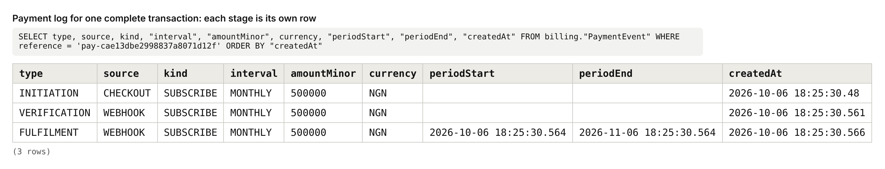
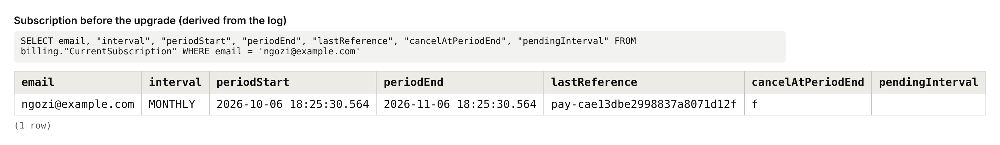
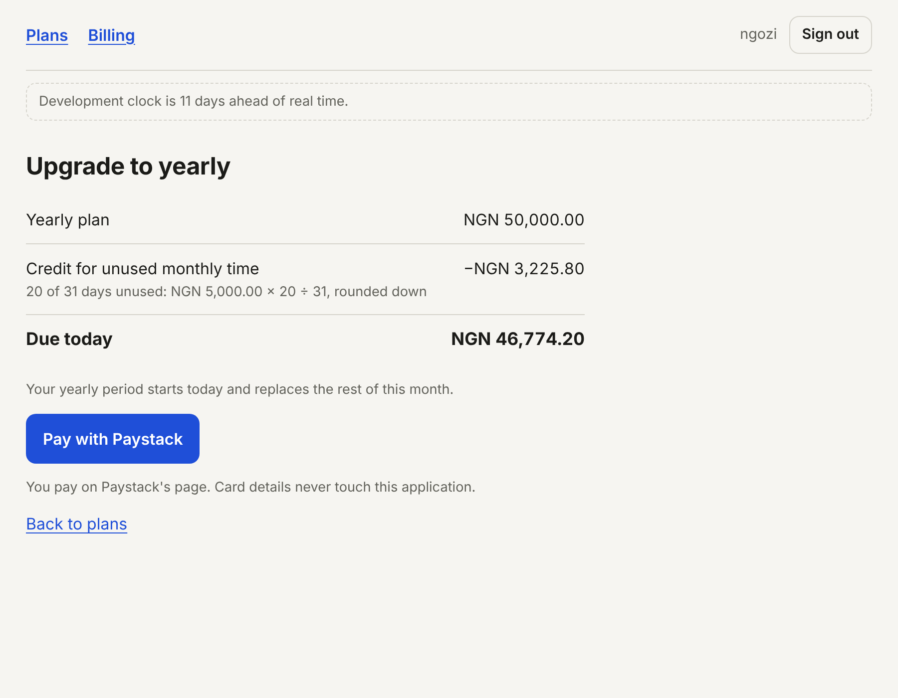
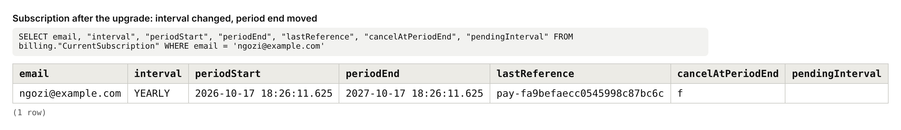
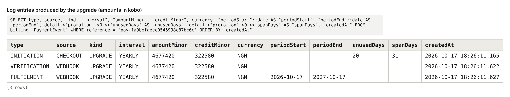
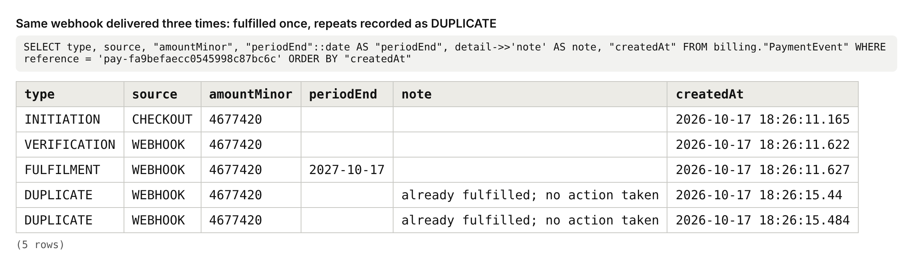
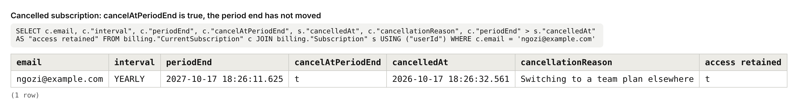
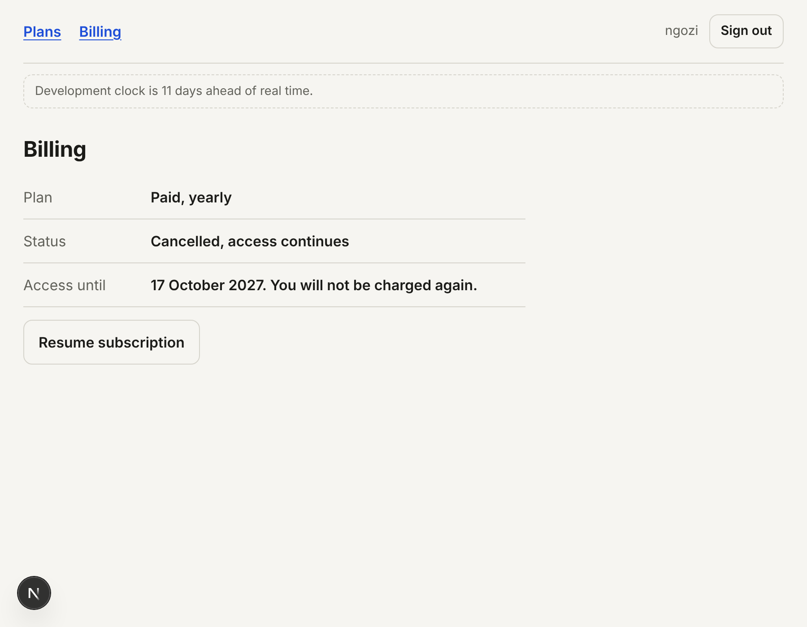
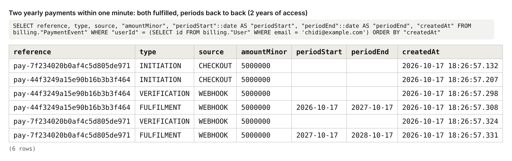

# Payment and Subscription Slice: Documentation

Assessment 2 of the Four Build Assessments. Stack: Next.js (App Router), TypeScript, Prisma, PostgreSQL. Payment provider: Paystack, test mode.

---

## Section 1: What This Is

This is a working subscription system for one paid plan sold on two intervals, monthly (NGN 5,000) and yearly (NGN 50,000). A signed-in user can subscribe, upgrade from monthly to yearly mid-cycle and pay a prorated amount, schedule a downgrade from yearly to monthly that takes effect at the end of the paid year, and cancel while keeping access until the period they paid for ends. Payment happens on Paystack's hosted page. Access is granted only after this server has asked Paystack, server to server, whether the money arrived, and every stage of every payment is written to an append-only log. The user's plan is not a stored field: it is worked out from that log each time it is needed.

It deliberately has no landing page, no pricing marketing page and no product features behind the paywall; the thing being sold is the plan itself. To have a signed-in user, it reuses the authentication slice from Assessment 1 (sign up, verify, sign in, reset, sign out) unchanged, in `src/lib/auth/`, `src/app/(auth)/` and `src/app/api/auth/`. That code is documented in the Assessment 1 repository and is not what is being assessed here. Refunds, invoices, receipts by email, taxes and multiple currencies are also left out, because the brief does not ask for them.

---

## Section 2: How To Run It

**What to install:** Node.js 20.12 or newer (built and tested on 22) and a PostgreSQL database, local or hosted.

1. Clone and install. `npm install` also generates the Prisma client.
   ```bash
   git clone https://github.com/daisydev11/payment-subscription-slice.git
   cd payment-subscription-slice
   npm install
   ```
2. Create your environment file and fill it in by hand.
   ```bash
   cp .env.example .env
   ```
   | Variable | Required | Where it comes from |
   |---|---|---|
   | `DATABASE_URL` | Yes | Your Postgres connection string. Keep `?schema=billing` on the end. |
   | `APP_URL` | Yes | Where the app runs. Locally `http://localhost:3000`. Used for the payment return link. |
   | `PAYSTACK_SECRET_KEY` | Yes | Paystack dashboard → Settings → API Keys & Webhooks → Test Secret Key (`sk_test_…`). With the simulator, any string. |
   | `PAYSTACK_BASE_URL` | No | Empty for the real Paystack API. `http://localhost:4010` for the local simulator. |
   | `CRON_SECRET` | Yes | Any long random string, e.g. from `openssl rand -hex 32`. The renewal job must present it. |
   | `CLOCK_OFFSET_DAYS` | No | Development only. Moves the billing clock forward to demonstrate mid-cycle upgrades and renewals. |
   | `RESEND_API_KEY`, `EMAIL_FROM` | No | For real emails. If empty, verification codes print to the server terminal. |
3. Create the tables.
   ```bash
   npx prisma migrate deploy
   ```
4. Start it.
   ```bash
   npm run dev
   ```
5. Open **http://localhost:3000**, create an account (the verification code appears in the terminal on a line starting `[email:dev]`), and you land on **Billing**.

**Two ways to take a payment**

- **Local simulator (no Paystack account needed, the documented local equivalent).** Set `PAYSTACK_BASE_URL="http://localhost:4010"`, and in a second terminal run `npm run simulator`. It serves the same four Paystack endpoints with the same payload shapes, shows a checkout page with Pay / Decline / Close buttons, and sends webhooks signed exactly as Paystack signs them (`dev/paystack-simulator.mjs`).
- **Paystack test mode.** Leave `PAYSTACK_BASE_URL` empty and use your `sk_test_` key. Pay with a Paystack test card. The return page verifies the payment by itself, so this works on localhost. For webhooks, Paystack needs a public address: expose the app (for example with a tunnel or a deployment) and set the webhook URL in the Paystack dashboard to `<public address>/api/webhooks/paystack`.

**Renewals** are run by a scheduler calling:
```bash
curl -X POST http://localhost:3000/api/cron/renew -H "Authorization: Bearer $CRON_SECRET"
```

Tests: `npm test` (40 tests; the settlement tests use the database in `.env`).

**About the evidence in this document:** it was captured by running this code against a real PostgreSQL database with the local simulator as the provider, and with the development clock moved forward where a date had to pass (11 days for the upgrade, 377 days for the renewal). Timestamps after those points therefore read 17 October 2026 and later.

---

## Section 3: The Flow, Step By Step

**1. Seeing the plans.** The user opens `/plans` (`src/app/(app)/plans/page.tsx`). The server calls `loadSubscription` in `src/lib/billing/entitlement.ts`, which reads the user's `FULFILMENT` rows from the payment log and derives the current plan. The page shows Free, Monthly and Yearly with the current one marked, and only the actions that make sense from there.

**2. Checkout initiation.** Choosing a plan opens `/checkout?interval=MONTHLY` (`src/app/(app)/checkout/page.tsx`). The server runs `quoteCheckout` in `src/lib/billing/proration.ts` and shows the price, any proration credit with its arithmetic, and the amount due today. Pressing "Pay with Paystack" sends `POST /api/billing/checkout` with `{ interval }`. The server (`src/app/api/billing/checkout/route.ts`, then `src/lib/billing/checkout.ts`) checks the session and the rate limit, recomputes the quote itself, generates a reference such as `pay-cae13dbe…`, writes an `INITIATION` row, and only then calls Paystack's `POST /transaction/initialize`. It returns the hosted checkout address and the browser leaves for Paystack. The amount is never taken from the browser.

**3. Paying.** The user enters card details on Paystack's page. This application never sees them.

**4. The webhook.** Paystack sends `POST /api/webhooks/paystack` (`src/app/api/webhooks/paystack/route.ts`). The server reads the raw body, recomputes the HMAC-SHA512 signature with the secret key and compares it with the `x-paystack-signature` header. A mismatch gets `401` and nothing else happens. A match hands the reference to `settlePayment`.

**5. The return view.** Paystack also redirects the user's browser to `/billing/return?reference=…` (`src/app/(app)/billing/return/page.tsx`). The server checks that the reference belongs to the signed-in user and calls the same `settlePayment`. Whichever of the webhook and the return arrives first does the work; the other finds it done.

**6. Verification and fulfilment.** `settlePayment` in `src/lib/billing/settle.ts` is the only place access is granted. It finds our `INITIATION` row, calls Paystack's `GET /transaction/verify/:reference`, and then, in one database transaction holding a per-user lock, writes a `VERIFICATION` row with what Paystack says it collected, compares amount and currency with the `INITIATION` row, and writes a `FULFILMENT` row carrying the period that payment bought. The return view then shows "Payment confirmed", "still confirming", "did not go through" or "could not find that payment". None of those is a blank page or a 404.

**7. Upgrading mid-cycle.** A monthly user chooses Yearly. Steps 2 to 6 run again, with two differences: the quote subtracts a credit for the unused days of the month, and the fulfilment starts a new yearly period today.

**8. Downgrading.** A yearly user presses "Switch to monthly" on `/plans` and confirms. The frontend sends `POST /api/billing/downgrade`. The server only sets `pendingInterval = MONTHLY` on the user's `Subscription` row. Nothing is charged and nothing in the log changes. The billing view now says "Renews on … at NGN 5,000.00 (switching to monthly)".

**9. Renewal.** A scheduler calls `POST /api/cron/renew` with the job secret. `runRenewals` in `src/lib/billing/renewals.ts` finds subscriptions whose paid period has ended and that are not cancelled, writes an `INITIATION` row with a deterministic reference (`rnw-<user>-<date>`), charges the stored provider token at the price of the pending interval if there is one, and passes the reference to the same `settlePayment`. This is where a scheduled downgrade takes effect.

**10. Cancelling.** On `/billing` the user presses "Cancel subscription" and sees a confirmation that states the date access continues to. "Yes, cancel" sends `POST /api/billing/cancel` with `{ confirm: true }`. The server sets `cancelAtPeriodEnd` and `cancelledAt`. The log is untouched, so the paid period is exactly as it was. An optional prompt then asks why; an answer is sent to `POST /api/billing/cancel/reason` and stored in `cancellationReason`. The renewal job skips cancelled subscriptions, so access simply runs out on the period end date.

---

## Section 4: The Data Model

Defined in `prisma/schema.prisma`. The constraints Prisma cannot express are hand-written in `prisma/migrations/20261006191000_billing/migration.sql`. The `User`, `Session`, `VerificationCode`, `PasswordResetToken` and `RateLimit` tables are reused from Assessment 1.

```prisma
model PaymentEvent {
  id          String           @id @default(cuid())
  userId      String           // FK -> User, ON DELETE RESTRICT
  reference   String
  type        PaymentEventType // INITIATION | VERIFICATION | FULFILMENT | FAILURE | DUPLICATE
  source      PaymentSource    // CHECKOUT | RETURN | WEBHOOK | RENEWAL
  kind        PaymentKind      // SUBSCRIBE | UPGRADE | RENEWAL
  interval    BillingInterval  // MONTHLY | YEARLY
  amountMinor Int
  currency    String
  creditMinor Int              @default(0)
  periodStart DateTime?
  periodEnd   DateTime?
  detail      Json?
  createdAt   DateTime
  @@index([userId, type, createdAt])
  @@index([reference])
}

model Subscription {
  userId                String           @id   // FK -> User
  cancelAtPeriodEnd     Boolean          @default(false)
  cancelledAt           DateTime?
  cancellationReason    String?
  pendingInterval       BillingInterval?
  providerAuthorization String?
  updatedAt             DateTime         @updatedAt
}
```

**PaymentEvent** is the payment log: one row per thing that happened to a payment.
- `reference` is the provider reference. We generate it, Paystack echoes it, and every row for one payment shares it.
- `type` is an enum, so a stage can only be one of the five known values.
- `amountMinor` is an `INTEGER` holding kobo. On a `VERIFICATION` row it holds what the provider says it collected; on the others, what we asked for.
- `currency` sits beside every amount, because 500000 means nothing without it.
- `creditMinor` is the proration credit applied to that charge.
- `periodStart` and `periodEnd` are nullable because only a `FULFILMENT` buys a period.
- `detail` is JSON for provider status, channel and reasons. It never holds card details.
- `userId` uses `ON DELETE RESTRICT`: a user with payment history cannot be deleted out from under it.
- `createdAt` is set by the application from the billing clock, so the log is in billing time.

**Subscription** holds the user's choices about the future and nothing about the present: whether to stop at period end, why, a scheduled interval change, and the provider's reusable token for renewals. There is no plan, status or date column here. One row per user, so `userId` is the primary key.

**CurrentSubscription** is a database view over the two tables, so the derived subscription can be read in a database tool. The application computes the same thing in `deriveState`.

### Which constraints in this schema make an invalid state impossible?

| Constraint | The invalid state it rules out |
|---|---|
| Trigger `PaymentEvent_append_only` (rejects `UPDATE` and `DELETE`) | A payment record that was edited or removed after the fact. Not even a bug in my own code can rewrite history. |
| Partial unique index on `reference` where `type = 'FULFILMENT'` | One payment granting access twice, however many webhooks, page refreshes or job runs arrive. |
| Partial unique indexes on `reference` for `INITIATION` and `VERIFICATION` | Two initiations sharing a reference (which would let one payment settle two orders), or a payment verified twice. |
| `INTEGER` type on `amountMinor` and `creditMinor` | A fractional amount such as 49.99 being stored. |
| `CHECK (amountMinor >= 0 AND creditMinor >= 0)` | A negative charge or negative credit. |
| `CHECK (currency ~ '^[A-Z]{3}$')` | An amount with a missing or malformed currency. |
| `CHECK` tying periods to type | A `FULFILMENT` without a period, a period that ends before it starts, or a non-fulfilment row that claims to grant a period. |
| `CHECK` on `Subscription` cancellation columns | A cancellation with no timestamp, or a cancellation reason on a subscription that is not cancelled. |
| `ON DELETE RESTRICT` on `PaymentEvent.userId` | Payment history orphaned by deleting its user. |
| Primary key on `Subscription.userId` | Two conflicting sets of choices for one user. |

---

## Section 5: The Concepts

### Minor Units, And Why Money Is Never A Decimal

**What it is.** A minor unit is the smallest piece of a currency: kobo for naira, cents for dollars. Storing money in minor units means storing NGN 5,000.00 as the whole number 500000, never as 5000.00.

**Why it is needed.** Computers store decimals like 0.1 in binary, where they cannot be represented exactly, so `0.1 + 0.2` is `0.30000000000000004`. In a payment system that error appears as a customer charged one kobo more than the receipt says, or a year of totals that does not reconcile with the provider's. Whole numbers add, subtract and compare exactly.

**How I implemented it.** `amountMinor` and `creditMinor` are `INTEGER` columns with the currency stored beside them. Prices are integers in `src/lib/config.ts` (`priceMinor: 500_000`). Paystack's API also takes kobo, so nothing is converted on the way out. The only division by 100 is for display, in `src/lib/billing/money.ts`. The one place fractions could appear is proration, which is done in integers:

```ts
creditMinor: Math.floor((valueMinor * unused) / total),
```

**What I chose against, and why.** A `DECIMAL(10,2)` column is exact in the database, but the value becomes a JavaScript float the moment it is read, and the inexactness comes back in application code. A decimal library would fix that at the cost of wrapping every amount in an object and remembering to do so everywhere. Integers need no discipline: the type itself cannot hold half a kobo.

### The Payment Lifecycle: Initiation, Verification, Fulfilment

**What it is.** A payment is three separate events. Initiation is my server recording an intent to collect an amount and asking the provider to collect it. Verification is my server asking the provider, directly, whether that money arrived. Fulfilment is my system granting what was paid for.

**Why it is needed.** If they are treated as one step, access gets granted at the wrong moment. Grant at initiation and people get the plan without paying. Grant when the browser lands on the success page and anyone who types that URL gets the plan free. Each stage can also fail alone: an initiated payment may be abandoned, and a verified payment may be for the wrong amount, so each needs its own record.

**How I implemented it.** Each stage is its own row in `PaymentEvent`. Initiation is written in `src/lib/billing/checkout.ts` before Paystack is called. Verification and fulfilment are written in `settlePayment` (`src/lib/billing/settle.ts`), after `provider.verify(reference)` returns success and inside one transaction:

```ts
// ENTITLEMENT IS GRANTED HERE, and only here.
await tx.paymentEvent.create({
  data: { ...carry(initiation, source), type: "FULFILMENT", periodStart, periodEnd, ... },
});
```

Between them, the amount and currency Paystack reports are compared with the `INITIATION` row; a mismatch writes a `FAILURE` and stops. The return page reaches this code only through a reference, which must match an `INITIATION` row belonging to the signed-in user, and the result still depends on what Paystack answers.

**What I chose against, and why.** The common shortcut is to trust the redirect: the provider sent the user to `/success`, so mark them paid. I chose against it because a redirect is a browser navigation that the user controls. I also chose against trusting the webhook's payload for the amount even after its signature checks out. Asking the provider again costs one request and means the return page, the webhook and the renewal job all run the same single code path.

### The Payment Log, And What It Proves In A Dispute

**What it is.** The payment log is a table where every event in a payment's life is added as a new row and no row is ever changed. A subscription's status says what is true now; the log says what happened and when.

**Why it is needed.** A customer disputes a charge from three months ago. A status column that says "active" answers nothing. I need to show: on this date you started a checkout for this amount; at this time the provider confirmed this amount by card; at this time we granted this period. Without the log I have only the provider's word, and no record of what my own system did in response.

**How I implemented it.** `PaymentEvent` is that table, and the database enforces that it only grows:

```sql
CREATE TRIGGER "PaymentEvent_append_only"
  BEFORE UPDATE OR DELETE ON "PaymentEvent"
  FOR EACH ROW EXECUTE FUNCTION "payment_event_append_only"();
```

The subscription itself is derived from it. `deriveState` in `src/lib/billing/entitlement.ts` takes the `FULFILMENT` rows and computes interval, period end and whether the user is entitled right now. Cancelling cannot remove paid access even by accident, because cancelling does not touch the log.

For the dispute: `SELECT * FROM "PaymentEvent" WHERE "userId" = … ORDER BY "createdAt"` returns the initiation (amount requested, proration breakdown in `detail`), the verification (amount collected, channel, the provider's `paid_at`), and the fulfilment (the exact period granted), each with its timestamp and shared reference, which is also the reference Paystack holds.

**What I chose against, and why.** The usual design is a `subscriptions` row with `plan`, `status` and `current_period_end` that code updates as things happen. It is simpler to query, but every update destroys the previous truth, and a bug that writes the wrong date leaves no trace of the right one. I also chose against keeping both a mutable row and a log, because two sources of truth eventually disagree and then neither can be trusted.

### Idempotency In Payments

**What it is.** An operation is idempotent when doing it many times has the same effect as doing it once. For payments, that means one payment grants one period, no matter how many times my system is told about it.

**Why it is needed.** Providers deliver webhooks at least once, and repeat them when a reply is slow. The user's return page and the webhook arrive within milliseconds of each other. People refresh. Without idempotency, each of those grants another period for a single charge, or a retried renewal job charges a card twice.

**How I implemented it.** The key is the provider reference. A partial unique index allows one fulfilment per reference:

```sql
CREATE UNIQUE INDEX "PaymentEvent_reference_fulfilment_key"
  ON "PaymentEvent"("reference") WHERE "type" = 'FULFILMENT';
```

`settlePayment` checks for an existing fulfilment, and checks again inside the transaction after taking a per-user advisory lock. A repeat is written as a `DUPLICATE` row and nothing else happens. The renewal job gets the same protection from a deterministic reference (`rnw-<user>-<period end date>`): a second run cannot insert a second `INITIATION`, so it cannot charge again. A test fires ten simultaneous webhooks for one reference and asserts one fulfilment and nine duplicates.

The related case is two *different* payments for the same thing, which idempotency does not cover because the references differ. Both are real money, so both are honoured: the second period starts where the first ends (evidence 7 below).

**What I chose against, and why.** A boolean `processed` flag read before processing has a race: two deliveries both read `false`. An in-memory set of seen references is lost on restart and not shared between server instances. I also chose against silently dropping duplicates. The brief asks for them to be recorded, and a log that shows "webhook delivered three times" is useful when debugging a provider.

### Webhook Signature Verification

**What it is.** A webhook is the provider calling my server to say something happened. A signature is a code the provider computes from the message body and a secret only the two of us know, so I can check the message really came from them and was not altered.

**Why it is needed.** The webhook URL is public. Without a signature check, anyone who guesses it can post `{"event":"charge.success", …}` and try to get a plan for free, or flood the endpoint to make my server call Paystack thousands of times.

**How I implemented it.** `isValidWebhookSignature` in `src/lib/billing/paystack.ts` computes HMAC-SHA512 of the raw body with the secret key and compares it with the `x-paystack-signature` header in constant time. The route checks it before parsing the body:

```ts
const rawBody = await request.text();
if (!isValidWebhookSignature(rawBody, request.headers.get("x-paystack-signature"))) {
  return NextResponse.json({ error: { code: "INVALID_SIGNATURE", ... } }, { status: 401 });
}
```

The body is read as text, not JSON, because the signature covers the exact bytes sent. Parsing and re-serialising could reorder keys or change spacing and break the match.

**What I chose against, and why.** Allow-listing Paystack's IP addresses is a second defence some teams use, but addresses change and depend on how my host forwards them, so I did not rely on it. I also chose against comparing the two strings with `===`, which returns faster the earlier they differ and can leak the correct signature one character at a time.

### Proration

**What it is.** Proration is charging in proportion to time. When a customer switches plans partway through a period they already paid for, they are credited for the part they did not use.

**Why it is needed.** Without it, a customer who upgrades on day 12 pays the full yearly price while most of a month they already paid for is thrown away. They are double charged for the same days, which is unfair and a likely chargeback.

**How I implemented it.** `prorationCredit` and `quoteCheckout` in `src/lib/billing/proration.ts`, with day counting in `src/lib/billing/periods.ts`. The rule, per paid monthly period:

```
credit = floor( value of the period × unused days ÷ days in the period )
charge = yearly price − credit
```

Unused days are counted to the day: a day counts as used once it is complete. The credit is rounded down so it can never exceed what was paid. The new yearly period starts on the day of the upgrade.

The real calculation from the evidence run. Monthly bought on 6 October 2026, period 6 October to 6 November (31 days), upgrade on 17 October, when 11 full days had passed:

| | |
|---|---|
| Days in the period | 31 |
| Days unused | 31 − 11 = **20** |
| Credit applied | floor(500,000 × 20 ÷ 31) = **322,580 kobo** (NGN 3,225.80) |
| Amount charged | 5,000,000 − 322,580 = **4,677,420 kobo** (NGN 46,774.20) |
| New period | 17 October 2026 → 17 October 2027 |

The textbook case, an upgrade on day 12 of a 30-day cycle, is a unit test in `tests/billing.test.ts`: 11 days passed, 19 unused, credit floor(500,000 × 19 ÷ 30) = 316,666 kobo, charge 4,683,334 kobo. The breakdown is shown to the user on the checkout page before they pay (evidence 3) and stored in the `INITIATION` row.

**What I chose against, and why.** Prorating by the second is more precise, but it produces a different amount every time the page reloads and cannot be checked by a customer with a calendar. The brief asks for "correct to the day". I chose against a fixed 30-day month because real periods are 28 to 31 days and the credit would be wrong most months. I also chose against extending the new period by the leftover days and charging the full price: it avoids the arithmetic, but the brief says the amount charged is prorated.

### Cancellation And Period-End Access

**What it is.** Cancelling a subscription means stopping future renewals. It does not undo a period that has already been paid for, so access continues until that period ends.

**Why it is needed.** The customer paid in advance for a defined period. If cancelling cut access at once, I would be keeping their money for time I then refused to deliver. That is a failure to provide a service that was paid for: a breach of the agreement under which the money was taken, the kind of practice consumer protection rules exist to stop, and a straightforward reason for the customer's bank to reverse the charge. It also teaches customers to wait until the last day to cancel, forget, and resent being billed again. The alternative that is fair in the other direction, a prorated refund, moves money back and is a much larger feature.

**How I implemented it.** Cancelling writes two columns and nothing else (`src/app/api/billing/cancel/route.ts`):

```ts
const flags = { cancelAtPeriodEnd: true, cancelledAt: at, pendingInterval: null };
await db.subscription.upsert({ where: { userId }, create: { userId, ...flags }, update: flags });
```

Access is derived from the payment log, which cancelling does not touch, so it is structurally unable to shorten a paid period. The renewal job filters on `cancelAtPeriodEnd: false`, so no further charge is made, and when the date passes the derived status becomes "Ended". The request must contain `{ confirm: true }`, so the confirmation step cannot be skipped by calling the endpoint directly. The optional reason goes into `cancellationReason` afterwards.

**What I chose against, and why.** Immediate cancellation with a refund of the unused days is defensible, but it needs refund calls, refund failures and refund records, none of which the brief asks for. Immediate cancellation without a refund is the trap the brief names. I also chose against deleting the subscription row on cancel, which would lose the reason and the cancellation time.

### Why Cards Are Not Stored, And PCI Scope

**What it is.** PCI DSS is the card industry's security standard. "Scope" means how much of my system the standard applies to, and it is decided by where card numbers go: every system that stores, processes or transmits them is in scope.

**Why it is needed.** If card numbers passed through my server or sat in my database, I would have to meet and prove hundreds of security requirements, and a breach of my database would be a breach of my customers' cards. A small product cannot carry that, and has no reason to.

**How I implemented it.** The user types card details only on Paystack's hosted page; my server sends them there with a redirect and gets back a reference. No form in this application has a card field. The one payment-related thing kept for renewals is Paystack's `authorization_code`, a token that only works with my secret key and is not card data. Paystack's response also contains the card's last four digits, brand and expiry, and the client drops them at the boundary so they cannot reach the database or logs (`normalise` in `src/lib/billing/paystack.ts`):

```ts
const reusable = raw.authorization?.reusable ? raw.authorization.authorization_code ?? null : null;
```

With a fully hosted payment page, the application falls under the lightest PCI self-assessment category, the one for merchants who have outsourced all card handling.

**What I chose against, and why.** An embedded card form on my own page looks more polished, but even when the fields post straight to the provider, my page becomes part of the payment path and my scope grows. Storing "just the last four digits" for display is permitted by the standard and common, but the brief says no card details anywhere, and the billing view does not need them.

### Rate Limiting On Payment Endpoints

**What it is.** Rate limiting caps how many times one client can call an endpoint in a period. On a payment endpoint it limits how many provider transactions one account can open.

**Why it is needed.** Each call to checkout initiation writes a row and makes a real API request to Paystack under my account. An unlimited endpoint lets one signed-in user, or a script with their cookie, open thousands of transactions a minute: my provider rate limit is exhausted for every other customer, my log fills with noise, and a provider may flag the account for unusual activity.

**How I implemented it.** The checkout route applies two limits before doing anything else, using the Postgres-backed atomic limiter from Assessment 1 (`src/lib/auth/rate-limit.ts`), with the numbers in `src/lib/config.ts`: 5 per 10 minutes per user and 20 per 10 minutes per IP.

```ts
const limitedResponse =
  (await limited("checkout-user", auth.user.id, checkoutByUser)) ??
  (await limited("checkout-ip", getClientIp(request), checkoutByIp));
if (limitedResponse) return limitedResponse;
```

Over the limit the response is `429` with `Retry-After`, and the Pay button counts down. Tested: the sixth initiation in ten minutes was refused (evidence 8).

**What I chose against, and why.** Limiting only by IP is the usual default, but this endpoint requires sign-in, and the account is the better key: one person on a shared office network should not be blocked by a colleague, and one account should not get more attempts by changing network. I did not rate limit the webhook endpoint the same way, because legitimate webhooks arrive in bursts and refusing them delays real payments. Its protection is the signature check, which rejects forgeries before any work is done.

### Evidence

**1. The payment log for one complete transaction.** Each stage is its own row with its own timestamp.



**2. The subscription record before the upgrade.** Monthly, ending 6 November 2026.



**3. Proration calculated and shown** on the checkout page, before paying.



**4. The subscription record after the upgrade.** The interval changed to yearly and the period end moved to 17 October 2027.



The log entries that resulted. Days unused 20 of 31, credit applied 322,580 kobo, amount charged 4,677,420 kobo:



**5. The same webhook fired three times.** The simulator's delivery log, then the database: one `FULFILMENT`, and each repeat recorded as `DUPLICATE` and ignored.

```
[simulator] webhook pay-fa9befaecc0545998c87bc6c -> 200 {"received":true,"outcome":"fulfilled"}
[simulator] webhook pay-fa9befaecc0545998c87bc6c -> 200 {"received":true,"outcome":"already_fulfilled"}
[simulator] webhook pay-fa9befaecc0545998c87bc6c -> 200 {"received":true,"outcome":"already_fulfilled"}
```



**6. A cancelled subscription with access retained.** `cancelAtPeriodEnd` is true, the reason is stored, and the period end is unchanged.





**7. Paying for yearly twice within one minute.** Two checkouts were opened and both were paid at the same moment. Both are fulfilled, and the second period starts where the first ends, so the customer has two years. A third attempt, made while the plan was active, was refused at initiation with `409 ALREADY_ON_PLAN` before any money moved.



**8. Refusals, as returned by the server.**

Webhook with no signature, then with a signature made from the wrong key:
```
{"error":{"code":"INVALID_SIGNATURE","message":"Signature check failed."}} [401]
{"error":{"code":"INVALID_SIGNATURE","message":"Signature check failed."}} [401]
```
A correctly signed webhook claiming success for a reference that was never paid. The server asked the provider and granted nothing:
```
{"received":true,"outcome":"failed"} [200]
```
Opening the return URL directly with a made-up reference, and with another user's paid reference: both render "We could not find that payment", and no plan changes.

The checkout rate limit, sixth initiation in ten minutes:
```
HTTP/1.1 429 Too Many Requests
retry-after: 599
{"error":{"code":"RATE_LIMITED","message":"Too many attempts. Try again in 599 seconds.","retryAfterSeconds":599}}
```
The provider switched off mid-flow. The user is told the truth and the failure is logged:
```
{"error":{"code":"PROVIDER_UNAVAILABLE","message":"The payment provider is not responding. You have not been charged. Try again in a moment."}} [502]
```

---

## Section 6: What Went Wrong

### 1. A second payment for the same upgrade vanished

- **The symptom.** I opened two upgrade checkouts for one monthly user and paid both. The log showed two `FULFILMENT` rows with the identical period, 18 October 2027 to 18 October 2028. The customer had paid NGN 45,000 twice and received one year.
- **The investigation.** I had already tested "pay for yearly twice" for a new subscriber, and that case extended correctly, so I first suspected the per-user lock was not holding. It was: the two fulfilments were written one after the other. The idempotency index was also irrelevant, because these were two different references. The difference from the working case was the payment kind.
- **The cause.** The period rule said "an upgrade starts a fresh year today", without asking whether the user was still on monthly. For the second payment the user was already yearly, so "today" bought a year they already owned. This is the exact failure the brief describes as absorbing the money silently.
- **The fix.** In `settlePayment`, an upgrade only starts a new period today if it is actually replacing a monthly plan. Otherwise it extends from the end of time already paid for, like any other repeat payment. A test, "paying for the same upgrade twice", now covers it.

### 2. Every payment had a FAILURE row before its FULFILMENT

- **The symptom.** In the first end-to-end run, the log for a successful payment read `INITIATION`, `FAILURE`, `VERIFICATION`, `FULFILMENT`.
- **The investigation.** The failure row's source was `RETURN` and it was written a second before the payment was made. I had loaded the return page before paying, to check that it granted nothing. It granted nothing, correctly, but it also wrote a failure.
- **The cause.** The provider reports a checkout that is open but unpaid as `abandoned`, and my code recorded every non-success status as a `FAILURE`. An unpaid checkout is not a failed payment; the same reference can be paid a minute later.
- **The fix.** `abandoned` now returns "not paid" to the user without writing a row. An `INITIATION` with nothing after it already says the checkout was never completed. `FAILURE` is kept for real declines, amount mismatches and provider outages. A test asserts that an abandoned reference can still be paid afterwards.

### 3. The per-user lock crashed every settlement

- **The symptom.** Four settlement tests failed with `Raw query failed … Failed to deserialize column of type 'void'`.
- **The investigation.** The stack trace pointed at the line taking the advisory lock, `SELECT pg_advisory_xact_lock(...)`. The SQL was valid; it ran in `psql`. So the database was doing its part and the client was failing on the reply.
- **The cause.** `pg_advisory_xact_lock` returns `void`. I had called it through Prisma's `$queryRaw`, which tries to convert every returned column into a JavaScript value and has no conversion for `void`.
- **The fix.** Use `$executeRaw`, which runs the statement and returns only a row count. The lock is taken and nothing needs converting.

### 4. Inherited from Assessment 1: Prisma's engine could not be downloaded

- **The symptom, cause and fix** are documented in the Assessment 1 repository: the network I built on blocked Prisma's binary host, so the client runs in engine-free mode with the `pg` driver adapter. The consequence here is that the migration SQL was hand-written, which turned out to be necessary anyway: the partial unique indexes, check constraints, trigger and view in this slice cannot be expressed in `schema.prisma`.

---

## Section 7: What This Slice Does Not Handle

**Left out because it is outside the brief**
- Refunds, invoices, emailed receipts, tax, coupons, trials, more than one currency, more than one paid plan.
- Product features behind the paywall. The plan is the product.

**Left out because I ran out of time**
- **A live run against Paystack's servers is not in the evidence.** Everything shown was produced with the local simulator, which follows Paystack's documented endpoints and signature scheme. The client code targets the real API by default, but a difference between the documentation and the live service would only show up in a real test-mode payment.
- **Failed renewals are not retried.** One attempt is made per period. If the card is declined, the subscription lapses and the user must subscribe again. A real system retries over several days and emails the customer.
- **No scheduler is included.** `POST /api/cron/renew` exists and is protected, but something outside this repository has to call it daily.
- **A double upgrade keeps its discount.** If two upgrade checkouts are opened and both paid, the second was priced with the same proration credit as the first. The customer gets both years, but paid slightly less for the second than list price.

**What I would need to add before real users touched it**
- **Reconciliation.** A job that compares Paystack's list of transactions with the log, to catch a payment whose webhook never arrived and whose user never returned. Today such a payment sits as an `INITIATION` until someone opens its return link.
- **A dunning and notification path:** emails for upcoming renewal, failed renewal, and cancellation confirmation.
- **Webhook events beyond `charge.success`,** in particular disputes and reversals, which should end the period they paid for.
- **A 64-bit amount column.** `INTEGER` tops out near NGN 21 million per row, which is fine for these prices and not for an enterprise plan.

**What breaks at scale**
- The renewal job loads every renewable subscription and derives each one in a loop. It needs a query that selects only the due ones, and batching.
- Entitlement is derived on every page load from all of a user's fulfilment rows. That is a handful of rows per user for years, but a cached or materialised current state would eventually be worth having.
- The rate limiter writes to Postgres on every checkout request, as noted in Assessment 1.

---

## Section 8: If I Built This Again

I would test against Paystack's real test mode from the first day, with the app reachable at a public address so webhooks arrive, and treat the simulator only as a way to run the test suite offline. I built and proved the logic against a stand-in I wrote myself, which made it fast to exercise the hard cases, such as declines, replayed webhooks, an outage and two payments landing together, but it also means the simulator and my client share one author's reading of the documentation. The parts of this slice I trust most are the ones a provider cannot affect: the log, the constraints, the proration arithmetic. The part I trust least is the thin layer that speaks to Paystack, and that is exactly the layer a real integration test would have covered.
